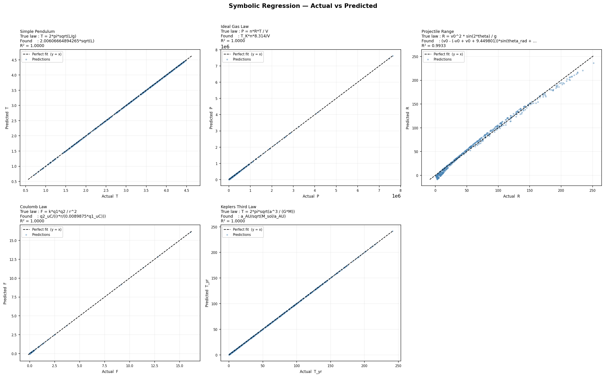

# Equation Discoverer

Give it a CSV, get back the equation that generated it.

Ordinary regression fits coefficients to a model *you* pick. This project searches over the
**structure** of the model itself and returns a closed-form expression you can read, check against
theory, and write in a paper.

Two engines, one interface:

| Mode | Engine | Finds | Input |
|---|---|---|---|
| Algebraic | [PySR](https://github.com/MilesCranmer/PySR) (genetic symbolic regression) | `y = f(x₁, x₂, …)` | any tabular CSV |
| Differential | [PySINDy](https://github.com/dynamicslab/pysindy) (sparse identification) | `ẋ = f(x)` | time-series CSV |




---

## Quick start

```bash
git clone https://github.com/<your-username>/equation-discoverer.git
cd equation-discoverer
pip install -r requirements.txt

cd equation_discoverer
streamlit run app.py
```

Upload a CSV in the sidebar, pick your feature and target columns, hit **Run**.

> **Julia is required.** PySR runs its search in Julia. Install Julia from
> [julialang.org](https://julialang.org/downloads/), then let PySR fetch its Julia packages on the
> first run (this takes several minutes, once). If you hit thread-count errors, set
> `PYTHON_JULIACALL_THREADS=1`.
>
> SINDy mode is optional. Without `pysindy` installed the app simply greys the toggle out.

---

## What's in the box

### The web app (`app.py`)

- CSV upload with missing-value handling and a data-preview tab
- Column pickers for features / target (algebraic) or time / state variables (differential)
- Exposed search parameters: iterations, max expression size, parsimony, trig operators on/off;
  polynomial degree and sparsification threshold for SINDy
- An 80/20 train-test split with **separate train and test R²**, plus an explicit overfitting
  warning when the gap exceeds 0.05
- The full **Pareto front** (complexity vs loss), not just the single winning equation
- Actual-vs-predicted scatter, and for SINDy a simulated-vs-actual trajectory per state variable

### Benchmark datasets (`physical_datasets.py`)

Five synthetic datasets generated from exact physical laws, sampled over physically realistic
ranges with a fixed seed. Each is written out in both raw SI units and a z-scored copy, so you can
test whether the search recovers the law from either.

| Dataset | Ground-truth law | Features |
|---|---|---|
| `simple_pendulum` | `T = 2π√(L/g)` | `L` |
| `ideal_gas_law` | `P = nRT/V` | `n`, `T_K`, `V` |
| `projectile_range` | `R = v₀² sin(2θ)/g` | `v0`, `theta_deg` |
| `coulomb_law` | `F = k·q₁q₂/r²` | `q1`, `q2`, `r` |
| `keplers_third_law` | `T = 2π√(a³/GM)` | `a`, `M` |

Because the true equation is known, the discovered expression can be scored against it rather than
only against the data.

### Batch runners

```bash
cd equation_discoverer

python discover_equations.py   # PySR over all five datasets, raw SI units
python norm.py                 # PySR on z-scored data, then algebraic denormalisation
python physical_datasets.py    # regenerate the CSVs in ./datasets/
```

---

## Design notes

**PySR runs in a subprocess.** Julia sizes its `PerThreadCache` to `Threads.nthreads()` at startup,
but Streamlit's background threads report `threadid()` values beyond that bound, which crashes the
search. `_pysr_subprocess.py` gives each run a fresh single-threaded Julia runtime: parameters go in
as JSON on stdin, the fitted model comes back as a pickle.

**Units are rescaled before the search.** Genetic search over raw SI values struggles when
magnitudes are extreme, so `discover_equations.py` preprocesses three cases:

- `projectile_range`: degrees to radians, so `sin(2θ)` is reachable in one operator
- `coulomb_law`: charges in µC, with relative-error weighting (`1/|F|`), because `F` spans ten
  orders of magnitude
- `keplers_third_law`: SI to AU / M☉ / years, putting every value in O(1–256)

**Normalisation is inverted symbolically.** `norm.py` runs the search on z-scored data and then uses
SymPy to substitute `(x − μ)/σ` back out, recovering an equation in physical units instead of
leaving it in standard-deviation space.

**Run artifacts are kept.** Every run writes its checkpoint and `hall_of_fame.csv` to a timestamped
directory under `outputs/` (CLI) or `outputs/app_run/` (app), so a result can be traced back later.
These are gitignored.

---

## Layout

```
equation-discoverer/
├── docs/                      README images
└── equation_discoverer/
    ├── datasets/              generated CSVs (raw + normalised)
    ├── app.py                 Streamlit app
    ├── _pysr_subprocess.py    isolated PySR worker
    ├── discover_equations.py  batch runner, raw SI units
    ├── norm.py                batch runner, z-scored + denormalised
    ├── physical_datasets.py   dataset generators and CSV export
    └── sindy_discover.py      PySINDy wrapper
```

---

## Built with

[PySR](https://github.com/MilesCranmer/PySR) · [PySINDy](https://github.com/dynamicslab/pysindy) ·
[Streamlit](https://streamlit.io) · [SymPy](https://www.sympy.org) ·
[scikit-learn](https://scikit-learn.org)
